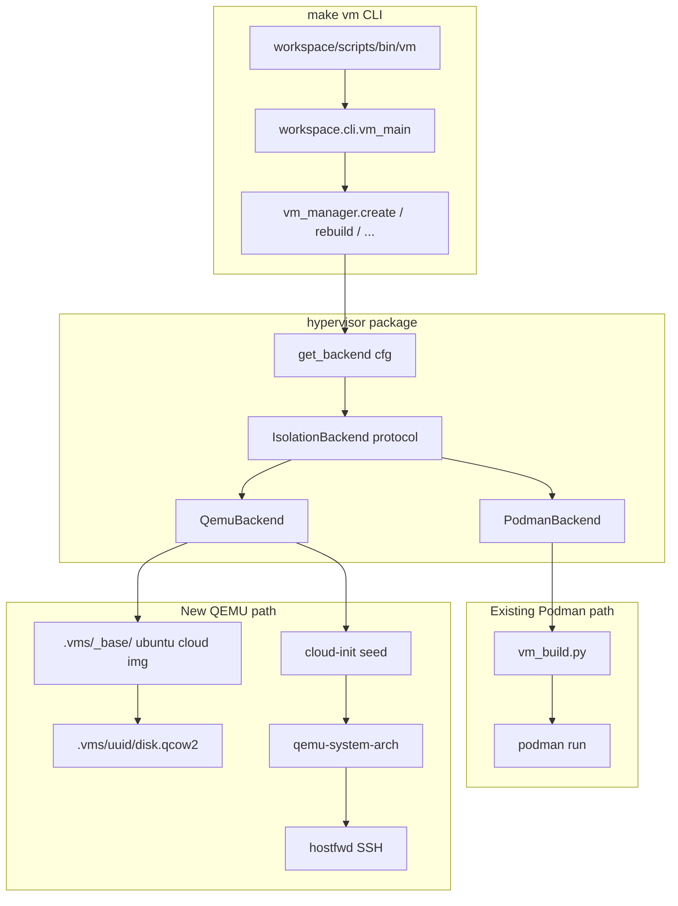

# VM Hypervisor Extension - Technical Specification

**Document ID:** WS-SPEC-VM-HYPERVISOR-v1.0
**Status:** Draft
**Date:** 2026-10-23
**Classification:** Internal - Enterprise
**Requirements:** [REQ-VM-HYPERVISOR](../requirements/REQ-VM-HYPERVISOR.md)
**References:**
- [REQ-VM-HYPERVISOR](../requirements/REQ-VM-HYPERVISOR.md)
- [REQ-OPENVPN](../requirements/REQ-OPENVPN.md)
- [REQ-ANDROID-WORKSPACE](../requirements/REQ-ANDROID-WORKSPACE.md)
- [workspace/types/vm.py](../../workspace/types/vm.py)
- [workspace/cli/vm_manager.py](../../workspace/cli/vm_manager.py)
- [workspace/cli/vm_build.py](../../workspace/cli/vm_build.py)
- [workspace/config/vm-template.yaml](../../workspace/config/vm-template.yaml)

---

## Overview

Extend `make vm` with a pluggable **isolation backend** layer. Podman remains the
default fast path for rootless agent containers. QEMU adds a true VM boundary for
host protection and WORKSPACE-GUARD authoritative testing.

Both backends share:

- YAML config → `VMConfig` pydantic model
- UUID7 lifecycle under `.vms/<uuid>/`
- `components` → `make install-ci` provisioning model
- `vm create` CLI entry point

They differ in spawn mechanics, health checks, and security field interpretation.

---

## 1. Architecture



### 1.1 Module layout

Current modules:

```
workspace/cli/
 hypervisor/
 __init__.py # get_backend(cfg) -> IsolationBackend
 base.py # IsolationBackend protocol
 podman_backend.py # delegates to existing vm_build/vm_manager paths
 qemu_backend.py # spawn, wait-ssh, stop, destroy
 qemu_argv.py # argv, firmware, monitor socket
 qemu_images.py # base image, overlay, cloud-init
 qemu_provision.py # rsync and install-ci profiles
 vm_manager.py # branch on cfg.isolation.backend
```

Planned modules, split to stay under the 512-line limit:

```
workspace/cli/hypervisor/
 qemu_state.py # persistent state, PID identity, recovery
 qemu_lifecycle.py # start, ACPI stop, rebuild, autostart
 qemu_guest_config.py # files, mounts, env, provider, credentials, ssh
 qemu_sync.py # day-2 rsync over SSH
 qemu_snapshots.py # snapshot, export, import
 qemu_network.py # none, bridge, proxy, OpenVPN
 qemu_security.py # guest hardening and validator rejects
```

### 1.2 `IsolationBackend` protocol surface

```python
class IsolationBackend(Protocol):
    def create(self, config_path: str, cfg: VMConfig) -> None: ...
    def start(self, uuid: str) -> None: ...
    def stop(self, uuid: str) -> None: ...
    def rebuild(self, uuid: str, *, fresh: bool = False) -> None: ...
    def sync(self, uuid: str) -> None: ...
    def destroy(self, uuid: str, *, purge: bool = False) -> None: ...
    def exec(self, uuid: str, cmd: list[str]) -> subprocess.CompletedProcess: ...
    def ssh_endpoint(self, uuid: str) -> tuple[str, int]: ...
    def status(self, uuid: str) -> dict[str, str]: ...
    def backend_name(self) -> str: ...
```

`PodmanBackend.create` SHALL call the existing `vm_manager.create` body
(extracted unchanged). `QemuBackend` implements the production path.

---

## 2. File Inventory

### Create

| Path | Purpose |
|------|---------|
| `docs/REQ-VM-HYPERVISOR.md` | Requirements (this initiative) |
| `docs/SPEC-VM-HYPERVISOR.md` | Technical spec (this document) |
| `workspace/cli/hypervisor/__init__.py` | `get_backend()` factory |
| `workspace/cli/hypervisor/base.py` | `IsolationBackend` protocol |
| `workspace/cli/hypervisor/podman_backend.py` | Thin wrapper over existing Podman flow |
| `workspace/cli/hypervisor/qemu_backend.py` | QEMU lifecycle orchestration (subprocess only) |
| `workspace/cli/hypervisor/qemu_argv.py` | Pure argv/firmware path builder (no I/O) |
| `workspace/cli/hypervisor/qemu_images.py` | Base image download, overlay, cloud-localds seed |
| `workspace/cli/hypervisor/qemu_resolve.py` | Binary/firmware resolution from boot-dir |
| `workspace/cli/hypervisor/qemu_state.py` | Persistent state and PID identity |
| `workspace/cli/hypervisor/qemu_qmp.py` | QMP ACPI powerdown client |
| `workspace/cli/hypervisor/qemu_guest_config.py` | Files, mounts, env, credentials, SSH, web UI, OpenVPN |
| `workspace/cli/qemu_sync.py` | Day-2 sync over SSH |
| `workspace/cli/vm_snapshots.py` | Snapshot, export, import |
| `workspace/cli/vm_autostart.py` | Systemd user autostart |
| `workspace/cli/hypervisor/qemu_argv.py` | Network modes and bridge NIC |
| `workspace/config/vm-poc-qemu.yaml` | Minimal QEMU baseline config |
| `workspace/scripts/bootstrap/bootstrap_qemu.sh` | Install/symlink QEMU, firmware, GPL notices |
| `res/qemu-pins.yaml` | Pinned versions, checksums, source URLs, and image digests |
| `tests/e2e/test_vm_qemu_poc.py` | Boot + SSH + `uname -a` E2E |
| `tests/unit/types/test_vm_isolation_config.py` | Schema validation unit tests |
| `tests/unit/cli/hypervisor/test_qemu_argv.py` | Argv builder unit tests |

### Edit

| Path | Change |
|------|--------|
| `workspace/types/vm.py` | Add `VMIsolationConfig`, `VMQemuConfig`; wire into `VMConfig` |
| `workspace/config/vm-template.yaml` | Document `isolation` block with defaults |
| `workspace/config/bootstrap-components.yaml` | Add `qemu` component |
| `config/system-deps.yaml` | Add `cloud-localds`, optional `qemu-utils` |
| `workspace/cli/vm_manager.py` | Dispatch `create` on `cfg.isolation.backend` |
| `workspace/scripts/bin/vm` | Backend-aware dispatcher with partial QEMU parity |
| `Makefile` | Add `install-qemu` target |
| `docs/MIGRATION-PLAN.md` | Cross-reference hypervisor extension (optional) |

### Unchanged (Podman path)

| Path | Reason |
|------|--------|
| `workspace/cli/vm_build.py` | Podman image build + run args - no QEMU changes |
| `workspace/scripts/templates/Dockerfile.vm.j2` | Container-only |
| `tests/e2e/test_vm_security.py` | Podman security assertions |

---

## 3. YAML Schema Extension

Add to `workspace/types/vm.py`:

```python
class VMQemuConfig(BaseModel):
    guest_arch: Literal["aarch64", "x86_64"] = "aarch64"
    accel: Literal["auto", "kvm", "hvf", "whpx", "tcg"] = "auto"
    disk_gb: int = 20
    ssh_host_port: int = 0  # 0 = auto-allocate
    image: str = "workspace-vm-base-ubuntu-24.04-aarch64.qcow2"


class VMIsolationConfig(BaseModel):
    backend: Literal["podman", "qemu"] = "podman"
    qemu: VMQemuConfig = Field(default_factory=VMQemuConfig)
```

Add to `VMConfig`:

```python
isolation: VMIsolationConfig = Field(default_factory=VMIsolationConfig)
```

### 3.1 `vm-template.yaml` addition

```yaml
# --- Isolation backend ---
# DEFAULT: podman - existing rootless agent containers (no breaking change).
# Use qemu for a full Linux guest and authoritative guard E2E.
# QEMU VMs are persistent by default. See docs/guides/PERSISTENT-QEMU-VM.md.
isolation:
 backend: podman # podman | qemu
 qemu:
 guest_arch: aarch64 # aarch64 | x86_64
 accel: auto # auto | kvm | hvf | whpx | tcg
 disk_gb: 20
 ssh_host_port: 0 # 0 = auto-allocate ephemeral port
 image: workspace-vm-base-ubuntu-24.04-aarch64.qcow2
 provision: none # none | guard | full-ci
```

### 3.2 Field applicability by backend

The target is full config parity. Every field is implemented or rejected with a
typed validation error. Silent ignore is not allowed.

| Field | Podman | QEMU current | QEMU target |
|-------|--------|--------------|-------------|
| `components`, `extra_apt` | install-ci in container build | SSH provision and `make install-ci` | Same, with resumable and complete profiles |
| `resources.memory`, `resources.cpus` | podman limits | QEMU `-m`, `-smp` | Same |
| `resources.pids_limit` | podman limit | systemd `DefaultTasksMax` | Guest systemd or cgroup limit |
| `security.*` | podman run flags | cap_add rejected; others partial | Guest controls or explicit reject |
| `network.mode: none` | no interfaces | `restrict=on` plus SSH forward | SSH-only restricted user networking |
| `network.mode: bridge` | Traefik plus mTLS | second virtio NIC on host bridge | Bridged interface on Linux |
| `network.mode: openvpn` | container or netns | guest client over user NAT; netns rejected | Guest client or host netns |
| `network.mode: host` | host network | rejected | Explicit reject |
| `web_ui` | OpenCode plus Traefik | guest OpenCode service on `:4096`; SSH tunnel | Guest OpenCode service, auth, and localhost forwarding |
| `mounts` | bind mounts | read-only virtio-9p | Additional read-only 9p shares |
| `files` | pre-copy to volume | copy into guest workspace | Copy into guest workspace |
| `sync` | `make vm sync` | QEMU `vm sync` over SSH | QEMU `vm sync` over SSH |
| `env` | container environment | `/etc/environment.d` | Guest login and service environment |
| `provider` | OpenCode config | guest OpenCode config | Guest OpenCode config |
| `credentials` | none, clone, api | none or clone; api rejected | Same modes with secret-safe handling |
| `ssh` | none, inherit, custom | same modes plus VM key | Same modes plus mandatory VM key |

Bridge policy mapping:

- `unrestricted`: no guest firewall rules.
- `internet`: drop private-range egress on the bridge NIC.
- `proxy`: drop all bridge egress except the resolved proxy host; export
  `HTTP_PROXY`, `HTTPS_PROXY`, and `NO_PROXY`.
- `whitelist`: rejected for QEMU.

---

## 4. `.vms/` Directory Layout

### 4.1 Shared per-VM (`Podman` and `QEMU`)

```
.vms/<uuid>/
 vm.yaml # frozen config at create time
 vm-install-defaults.yaml
 password # Podman: container password; QEMU: guest console password
 certs/ # Podman mTLS; QEMU web UI mTLS
 state.yaml # backend state, mode, profile, last error
```

### 4.2 Podman-only additions

```
 pid # container PID on host
```

Podman also creates named volumes: `<uuid>-workspace`, `<uuid>-transcripts`, `<uuid>-cache`.

### 4.3 QEMU-only additions

```
.vms/<uuid>/
 qemu.pid # host PID of qemu-system-* process
 qmp.sock # QMP control socket, mode 0600
 ssh_port # forwarded localhost port (e.g. 55222)
 disk.qcow2 # per-VM overlay, persistent by default
 cloud-init/
 user-data
 meta-data
 seed.img # seed for -drive file=seed.img
 qemu.log # optional stdout/stderr capture
 provision.log # install-ci / rsync output from qemu_provision.py
 state.yaml # persistent or ephemeral, profile, timestamps, last error
 snapshots/ # internal QCOW2 snapshots
 exports/ # portable export bundles
 autostart/ # systemd user unit metadata
```

### 4.4 Shared base cache

```
.vms/_base/
 workspace-vm-base-ubuntu-24.04-aarch64.qcow2 # downloaded once
 workspace-vm-base-ubuntu-24.04-x86_64.qcow2 # optional second arch
```

Base image bootstrap:

1. On first QEMU create, ensure `.vms/_base/` exists
2. Download Ubuntu minimal cloud image if missing (checksum verified)
3. `qemu-img create -f qcow2 -b <base> -F qcow2 <vm_dir>/disk.qcow2`
4. `qemu-img resize <vm_dir>/disk.qcow2 <disk_gb>G`

---

## 5. PodmanBackend

`PodmanBackend` is a **thin adapter**. `create()` SHALL execute the current
`vm_manager.create` logic without modification:

1. `_ensure_podman_machine()`
2. Stage VPN assets, build context, render Dockerfile, `podman build`
3. Create volumes, certs, bridge network, netns preflight
4. `podman run` with `_build_run_args` security flags
5. `_wait_healthy` via container healthcheck

No QEMU artifacts. `cfg.isolation.backend` is ignored except for backend selection.

---

## 6. QemuBackend

### 6.1 Create sequence

```
create(uuid, cfg, vm_dir):
 1. validate persistent or ephemeral mode and config field support
 2. resolve_qemu_binary(guest_arch) # boot-dir only
 3. resolve_accel(cfg.isolation.qemu) # auto -> kvm/hvf/whpx/tcg
 4. ensure_base_image(image_name)
 5. create_overlay(vm_dir/disk.qcow2)
 6. generate_cloud_init(cfg, vm_dir)
 7. allocate_ssh_port() and write ssh_port
 8. write state.yaml with mode and provisioning profile
 9. build_argv() with QMP socket
10. spawn QEMU and record PID identity
11. wait_ssh_healthy(host, port)
12. apply mounts, host shares, limits, files, env, provider, credentials, and SSH
13. run the provisioning profile when components are present
14. restart provisioned VMs with `restrict=on` when `network.mode: none`
15. mark state ready or failed with a resumable checkpoint
```

The first boot of a provisioned VM permits host networking so cloud-init can
install `make`, `rsync`, and toolchain packages. The guest prebuilds guard
binaries and persists the cargo cache under `/var/tmp`; later boots mount host
shares explicitly because cloud-init `runcmd` is first-boot only.

The create path SHALL be ordered so a failure after step 8 leaves a VM that can
be inspected, retried, or purged. It SHALL NOT leave an untracked QEMU process.

### 6.2 QEMU argv (aarch64 Linux guest)

Built by `qemu_argv.py` from boot-dir paths. Firmware is mandatory for `virt`.
The persistent target adds `-qmp unix:<vm_dir>/qmp.sock,server=on,wait=off` and
uses `-netdev user,...,restrict=on` when `network.mode: none`.

```bash
qemu-system-aarch64 \
 -accel kvm|hvf|tcg \
 -cpu max \
 -machine virt,gic-version=3,acpi=on \
 -m 4096 \
 -smp 2 \
 -bios <boot-dir>/share/qemu/firmware/QEMU_EFI.fd \
 -drive file=.vms/<uuid>/disk.qcow2,if=virtio,format=qcow2 \
 -drive file=.vms/<uuid>/cloud-init/seed.img,format=raw,if=virtio \
 -netdev user,id=net0,hostfwd=tcp:127.0.0.1:<ssh_port>-:22 \
 -device virtio-net-pci,netdev=net0 \
 -device virtio-rng-pci \
 -fsdev local,id=ws0,path=<workspace_root>,security_model=none,readonly=on \
 -device virtio-9p-pci,fsdev=ws0,mount_tag=workspace \
 -display none \
 -pidfile .vms/<uuid>/qemu.pid \
 -daemonize
```

`<workspace_root>` is `find_workspace_root()` (WORKSPACE-VM repo root). The 9p share
is read-only on the host; guest writes go to `/opt/workspace` on the QCOW2 overlay only.

- Linux + KVM: `-accel kvm`, `-cpu host` when `guest_arch` matches host
- macOS: `-accel hvf`, `-cpu max` (no `host` CPU on HVF for aarch64 guest)
- Fallback: `-accel tcg`, `-cpu max`

x86_64 guest uses `qemu-system-x86_64`, `-machine q35`, OVMF pflash or `-bios` per pin file.

### 6.3 Cloud-init `user-data` (baseline)

```yaml
#cloud-config
users:
 - name: workspace
   sudo: ALL=(ALL) NOPASSWD:ALL
   shell: /bin/bash
   ssh_authorized_keys:
    - <build-time ed25519 pubkey>
 - name: agent
   uid: 1001
   shell: /bin/bash
   groups: [users]
package_update: true
packages:
 - openssh-server
 - git
 - curl
 - rsync
 - make
 - build-essential
runcmd:
 - systemctl enable --now ssh
 - mkdir -p /mnt/workspace-ro
 - mount -t 9p -o trans=virtio,version=9p2000.L,ro workspace /mnt/workspace-ro
```

SSH key generation reuses `_prepare_build_ssh_key` pattern from `vm_build.py`.
`make install-ci` is **not** run in cloud-init (timeouts); `qemu_provision.py` runs
it over SSH after health check when `components` is non-empty.

### 6.4 Health check

Replace container healthcheck with SSH probe:

```bash
ssh -o StrictHostKeyChecking=no -o ConnectTimeout=5 \
 -p "$ssh_port" workspace@127.0.0.1 echo ok
```

Poll until success or timeout (same order of magnitude as existing `_wait_healthy`).

### 6.5 Stop / destroy

Implemented behavior:

- **stop:** connect to `qmp.sock`, issue `system_powerdown`, wait for guest
  shutdown, then SIGTERM, then SIGKILL. Report success only after exit.
- **destroy without purge:** stop, then move the VM directory to
  `.vms/_archive/<uuid>/`. Artifacts remain recoverable.
- **destroy with purge:** stop and remove all per-VM artifacts. Retain `_base/`.
- **stale PID:** verify process identity before signalling or declaring running.
- **recovery:** missing disk, broken backing chain, or occupied SSH port fail
  with a named error and a remediation hint.

### 6.6 Guest provisioning and rsync profiles

`workspace/cli/hypervisor/qemu_provision.py` orchestrates post-boot setup:

1. Wait for `/mnt/workspace-ro` (cloud-init mount).
2. Rsync selected paths from RO mount to `/opt/workspace` (guest disk).
3. `cd /opt/workspace && make init && make install-ci INSTALL_DEFAULTS=...`
4. Stream output to `.vms/<uuid>/provision.log`.

Current profile behavior:

| Profile | Config | Rsync scope | install-ci |
|---------|--------|-------------|------------|
| `none` | `vm-poc-qemu.yaml` | None | No |
| `guard` | `vm-guard-qemu.yaml` | Skeleton plus WORKSPACE-GUARD | Minimal, no install-ci |
| `full-ci` | `vm-full-ci-qemu.yaml` | Skeleton plus CI, DATAOPS, GUARD, BROWSER | Yes, 13 components |

Target profile behavior:

| Field | Target |
|-------|--------|
| `provision` | `none`, `guard`, `full-ci`, `persistent` |
| workspace scope | `minimal`, `required`, `all` |
| update mode | `create-only`, `sync`, `git-pull` |
| failure recovery | resumable state and explicit partial-artifact policy |

The `full-ci` profile currently copies four project repositories, not all of
`projects/`. Documentation SHALL NOT claim full project coverage until the
`workspace_scope: all` implementation and E2E test exist.

**Always excluded from rsync:** `.vms/`, `.venv/`, `node_modules/`, `__pycache__/`.

**Optional (`QEMU_RSYNC_BOOT=1`, same host arch only):** copy host `.boot-linux/` into
guest to skip cold downloads. macOS host `.boot-macos/` is never copied (wrong arch).

Environment knobs:

| Variable | Default | Effect |
|----------|---------|--------|
| `QEMU_PROVISION_PROFILE` | derived from config | `poc` / `guard` / `full-ci` |
| `QEMU_RSYNC_BOOT` | `0` | Copy pre-built `.boot-linux/` when `1` |
| `QEMU_PROVISION_TIMEOUT` | `3600` | Seconds for install-ci |

Disk guidance: `disk_gb: 12` for the baseline profile; `48` for full-ci (base image + overlay + install artifacts).

### 6.7 E2E storage cleanup

QEMU E2E tests (`tests/e2e/test_vm_qemu_*.py`) MUST NOT persist per-VM overlays:

| Artifact | After E2E | Rationale |
|----------|-----------|-----------|
| `.vms/<uuid>/` (overlay, cloud-init, logs) | **Deleted** | `qemu_tracker` fixture + session reclaim |
| `.vms/_base/` (shared Ubuntu image) | **Retained** | Avoid re-downloading ~600MB per run |
| Failed partial creates | **Reclaimed** | `cleanup_orphan_qemu_vms()` on session end |

Debug only: set `QEMU_E2E_KEEP_VM=1` to skip destroy (not for CI).

Target cleanup rule:

- `state.yaml` with `mode: persistent` SHALL make the VM ineligible for automatic
  reclamation.
- `cleanup_orphan_qemu_vms()` SHALL skip persistent VMs even when age is zero.
- `make clean-qemu-e2e` SHALL remove only ephemeral E2E VMs.
- The cleanup command SHALL print skipped persistent VMs.

### 6.8 Persistent lifecycle

Add a typed `state.yaml` per VM:

```yaml
mode: persistent # persistent | ephemeral
profile: full-ci
created_at: "2026-10-23T00:00:00Z"
last_started_at: "2026-10-23T00:00:00Z"
last_stopped_at: null
last_error: null
qemu_pid_start_ticks: 123456
ssh_port: 55222
```

Rules:

- `start` validates disk, backing chain, state, PID identity, and SSH port.
- A stale PID file is not proof of a running VM.
- `stop` uses QMP ACPI shutdown before signals.
- Host reboot preserves the overlay and state file.
- `status` reports `persistent`, `ephemeral`, `running`, `stopped`, `invalid`.

### 6.9 Rebuild and sync

- `vm rebuild <id>` regenerates cloud-init and guest configuration.
- Preserve the overlay by default.
- `--fresh` creates a new overlay and keeps the old one under `backups/`.
- Rebuild re-runs provisioning and emits a resumable state checkpoint.
- `vm sync <id>` applies `sync` rules over SSH.
- Strategies: `merge`, `overwrite` with delete, `skip` for existing files.
- The sync command SHALL reject absolute or escaping destination paths.

### 6.10 Snapshot, export, import

- `vm snapshot create|list|delete` uses `qemu-img snapshot` or a stopped VM copy.
- Snapshots require a stopped or quiesced VM in the first release.
- `vm export` writes `disk.qcow2`, `vm.yaml`, `vm-install-defaults.yaml`,
  `state.yaml`, `password`, `qemu_ssh_ed25519`, `cloud-init/`, and a manifest.
- The bundle contains the per-VM SSH private key and password. Treat it as a
  secret and restrict access to the destination directory.
- Export excludes host secrets and `_base/`.
- `vm import` validates the manifest, checks disk integrity, and assigns a new
  UUID. It preserves the bundled key and password so the imported VM is
  reachable without guest console access.
- Backup tests SHALL verify full-ci state and workspace content.

### 6.11 Autostart

- `vm autostart enable <id>` writes a systemd user unit.
- `vm autostart disable <id>` removes it.
- Unit uses the exact VM UUID and stored config.
- Persistent only. Ephemeral VMs are rejected.
- Tests run in an isolated systemd user scope or skip with an explicit reason.

### 6.12 Config parity and network

- Implement `files`, `mounts`, `env`, `provider`, `credentials`, `ssh`, and
  `web_ui` for QEMU.
- Implement network `none`, `bridge`, `proxy`, and `openvpn`.
- Reject `host` network mode for QEMU.
- Every unsupported field fails validation with field name and remediation.
- QEMU `none` uses restricted user networking; only SSH host forwarding works.
- Web UI binds to guest localhost and is forwarded to host localhost with auth.

### 6.13 Windows and Android rootless bootstrap

- Native Windows WHPX and native Android packages are separate workstreams.
- Windows and Android developers use WSL or chroot on local Debian or Ubuntu.
- The bootstrap path runs `make init`, `make install-qemu`, and the same VM CLI.
- E2E SHALL record results for WSL and chroot separately from native Linux.
- Path, socket, systemd, and storage assumptions SHALL have WSL and chroot tests.

---

## 7. Accelerator Resolution

```python
def resolve_accel(requested: str, host_os: str, qemu_bin: Path) -> str:
 if requested != "auto":
 return requested
 if host_os == "linux":
 return "kvm" if _probe_accel(qemu_bin, "kvm") else "tcg"
 if host_os == "darwin":
 return "hvf" if _probe_accel(qemu_bin, "hvf") else "tcg"
 if host_os == "win32":
 return "whpx" if _probe_accel(qemu_bin, "whpx") else "tcg"
 return "tcg" # Android / unknown
```

`_probe_accel` runs `qemu-system-* -accel <name> -machine none -display none` and
checks exit code.

---

## 8. CLI Parity Matrix

| Subcommand | Podman | QEMU current | QEMU target |
|------------|--------|--------------|-------------|
| `create` | full | full | full with resumable provisioning |
| `rebuild` | full | preserve overlay; `--fresh` recreates | preserve overlay by default, `--fresh` option |
| `start` | `podman start` | spawn if stopped; validate PID identity | validate state and identity |
| `stop` | `podman stop` | QMP ACPI, SIGTERM, SIGKILL | QMP ACPI, SIGTERM, SIGKILL |
| `delete` | container plus volumes | archive by default; `--purge` removes | preserve by default, `--purge` removes |
| `shell` | `podman exec -it` | SSH | SSH with per-VM key |
| `exec` | `podman exec` | SSH | SSH with exit-code propagation |
| `logs` | `podman logs` | `tail qemu.log` | follow and tail with rotation |
| `list` | podman labels | scan PID files | typed state, no stale PID trust |
| `status` | podman inspect and stats | minimal | backend, state, port, disk, profile |
| `sync` | rsync to volume | rejected | rsync over SSH with strategies |
| `snapshot` | not applicable | missing | create, list, delete |
| `export` | missing | missing | portable bundle |
| `import` | missing | missing | validated restore |
| `autostart` | missing | missing | systemd user unit enable and disable |

`vm` shell script reads `vm.yaml` and `state.yaml` to dispatch.

---

## 9. GPL compliance and module boundaries

### 9.1 Legal model

QEMU is GPL-2.0. WORKSPACE-VM Python and shell code is proprietary to the workspace
and invokes QEMU as a **separate program** (GPL FAQ: running an external program is
not creating a derivative work). Distribution obligations attach to **QEMU binaries**
we ship or symlink into `<boot-dir>/`, not to the orchestrator.

| Layer | License | QEMU coupling |
|-------|---------|---------------|
| `workspace/cli/hypervisor/*.py` | Workspace | `subprocess.run([qemu_bin, ...])` only |
| `workspace/scripts/bootstrap/bootstrap_qemu.sh` | Workspace | Installs upstream binaries + notices |
| `<boot-dir>/bin/qemu-system-*` | GPL-2.0 | Upstream, unmodified |
| `<boot-dir>/share/qemu/firmware/*` | BSD (EDK2) | Upstream distro packages |
| `.vms/_base/*.qcow2` | Ubuntu terms | Guest image, not linked |
| Guest cloud-init seed | Workspace-generated data | Not a derivative of QEMU |

**Prohibited in v1:**

- `import ctypes` / `cffi` loading `libqemu`
- Static linking QEMU into Rust/Python extensions
- Patching QEMU without publishing modified source

### 9.2 Boot-directory notice bundle

After `bootstrap_qemu.sh`:

```
.boot-linux/share/qemu/
 LICENSE # GPL-2.0 full text (from qemu.org or package)
 NOTICE # version, tarball URL, build date
 firmware/
 QEMU_EFI.fd # from qemu-efi / edk2-aarch64 (Linux apt)
```

`NOTICE` template:

```
QEMU system emulator
Version: <from res/qemu-pins.yaml>
Binary: qemu-system-aarch64, qemu-img
Source: https://download.qemu.org/qemu-<version>.tar.xz
License: GNU General Public License v2.0
```

### 9.3 Code layout rule

```
hypervisor/
 qemu_argv.py # pure functions - argv, firmware paths (unit-testable)
 qemu_resolve.py # boot-dir → Path, PATH selection with warning
 qemu_images.py # download, qcow2 overlay, cloud-localds
 qemu_backend.py # IsolationBackend - wires the above, subprocess only
```

No single file imports QEMU internals. `qemu_argv.py` has zero subprocess calls so
tests do not need QEMU installed.

---

## 10. QEMU bootstrap

### 10.1 Component registration

`workspace/config/bootstrap-components.yaml`:

```yaml
 - name: qemu
 label: 'QEMU'
 description: 'VM hypervisor (GPL-2.0, subprocess-only integration)'
 type: script
 group: 'Infrastructure & Orchestration'
 script: 'bootstrap_qemu.sh'
 detect_path: '.boot-linux/bin/qemu-system-aarch64'
 version_cmd: ['.boot-linux/bin/qemu-system-aarch64', '--version']
 version_pattern: 'QEMU emulator version (\d+\.\d+\.\d+)'
```

macOS `detect_path` resolves via boot-dir resolver (`.boot-macos/...`).

### 10.2 `res/qemu-pins.yaml` schema

```yaml
version: 1
qemu:
 version: "9.2.1"
 source_url: "https://download.qemu.org/qemu-9.2.1.tar.xz"
 source_sha256: "<sha256>"
linux:
 apt_packages:
 - qemu-system-arm
 - qemu-system-x86
 - qemu-utils
 - qemu-efi-aarch64 # provides QEMU_EFI.fd
 min_version: "9.2.0"
darwin:
 brew_package: qemu
 min_version: "9.2.0"
firmware:
 aarch64_edk2:
 linux_path: /usr/share/qemu-efi-aarch64/QEMU_EFI.fd
 darwin_path: <brew-prefix>/share/qemu/edk2-aarch64-code.fd
images:
 ubuntu_2404_arm64:
 url: "https://cloud-images.ubuntu.com/releases/24.04/release/ubuntu-24.04-server-cloudimg-arm64.img"
 sha256: "<pin at bootstrap time>"
 dest_name: workspace-vm-base-ubuntu-24.04-aarch64.qcow2
```

Pins are checked at bootstrap; mismatch SHALL fail in CI and emit a warning in local development.

### 10.3 `bootstrap_qemu.sh` steps

1. Resolve `BOOT_DIR` / `BIN_DIR` / `SHARE_DIR` (same pattern as `bootstrap_openvpn.sh`)
2. Read `res/qemu-pins.yaml` via `uv run python -c` or `yq`
3. **Linux:** `apt-get install` pinned packages OR verify existing versions; symlink into `BIN_DIR`
4. **macOS:** `brew install qemu`; symlink `qemu-system-aarch64`, `qemu-img`
5. Copy firmware into `SHARE_DIR/firmware/` (symlink if stable path exists)
6. Install `LICENSE` + write `NOTICE` with resolved version
7. Print `qemu-system-aarch64 --version` for operator confirmation

Symlinks preferred over copying binaries so GPL source offer stays with the distro
package (apt/brew) while boot-dir remains the runtime resolution point.

### 10.4 Resolution order (`qemu_resolve.py`)

```
1. <boot-dir>/bin/qemu-system-<guest_arch>
2. fail with: "run make install-qemu"
```

PATH selection is forbidden. The current code still allows PATH selection;
removing it is part of the production gap backlog.

Same for `qemu-img` and firmware under `<boot-dir>/share/qemu/firmware/`.

### 10.5 Host dependencies (`config/system-deps.yaml`)

```yaml
 - check_cmd: cloud-localds
 apt_package: cloud-image-utils
 brew_package: cloud-utils
 description: cloud-init seed image builder (cloud-localds)
 component: qemu

 - check_cmd: qemu-img
 apt_package: qemu-utils
 description: QEMU disk image tool (skipped when bootstrapped)
 component: qemu
 optional: true
```

`cloud-localds` builds `seed.img` from `user-data` + `meta-data`:

```bash
cloud-localds .vms/<uuid>/cloud-init/seed.img \
 .vms/<uuid>/cloud-init/user-data \
 .vms/<uuid>/cloud-init/meta-data
```

---

## 11. Guest images and firmware

### 11.1 Base image cache (`.vms/_base/`)

Already gitignored via `.vms/*`. Download once; verify SHA256 from
`res/qemu-pins.yaml#images`.

Convert raw cloud image to qcow2 backing file on first fetch:

```bash
qemu-img convert -O qcow2 ubuntu-24.04-server-cloudimg-arm64.img \
 .vms/_base/workspace-vm-base-ubuntu-24.04-aarch64.qcow2
```

### 11.2 Per-VM overlay

```bash
qemu-img create -f qcow2 -b .vms/_base/<image> -F qcow2 .vms/<uuid>/disk.qcow2
qemu-img resize .vms/<uuid>/disk.qcow2 <disk_gb>G
```

### 11.3 Firmware by guest architecture

| Guest | Machine | Firmware | Source |
|-------|---------|----------|--------|
| aarch64 | `virt` | `QEMU_EFI.fd` | `qemu-efi-aarch64` (apt) / brew qemu share |
| x86_64 | `q35` | OVMF code+vars pflash | `ovmf` (apt) / brew |

Firmware paths resolved in `qemu_argv.py` from boot-dir bundle first.

### 11.4 KVM prerequisite (Linux)

`QemuBackend.create` SHALL probe `/dev/kvm` when accel resolves to `kvm`. If missing,
it SHALL select `tcg` when `accel: auto` and report that selection, or fail when
`accel: kvm` is explicit.

Document in error text: `sudo usermod -aG kvm $USER` and re-login.

---

## 12. WORKSPACE-GUARD Integration

### 12.1 Authority model

| Gate | Where it runs | Authority |
|------|---------------|-----------|
| `cargo test` (Rust unit) | Podman / bare Linux | Dev sanity check |
| `make test-podman` Tier 1-2 | Podman container | Dev sanity check |
| `e2e-capability.sh` Tier 3 | **QEMU guest only** | **Authoritative** |
| Policy matrix E2E on real caps | **QEMU guest only** | **Authoritative** |
| Shell-guard runtime + lifecycle (`e2e-shell-guard-guest.sh`) | **QEMU guest only** | **Authoritative** |
| Darwin Podman | - | **Not authoritative** for kernel guardrails |

The shell-guard battery is QEMU-only for the same reason as Tier 3,
plus two compounding host restrictions: rootless Podman stores file
capabilities as `user.overlay` xattrs the kernel never honors (no
AT_SECURE), and Ubuntu hosts gate unprivileged user-namespace
creation behind AppArmor profiles, so nested-namespace integration changes
are denied. The bats suite `tests/shell/21-shell-guard.bats` runs
the same matrix wherever a capability context is attainable and
skips honestly elsewhere; only the AT_SECURE-gate test runs
everywhere.

Windows and Android guard runs use the rootless bootstrap path on a local
Debian or Ubuntu environment under WSL or chroot. They SHALL run the same
`make test-vm-guard` and `make test-vm-shell-guard` gates. Native Windows
WHPX and native Android packaging are separate workstreams and SHALL NOT be
claimed as validated until their own gates exist.

### 12.2 Authoritative gate (host orchestration)

From WORKSPACE-VM root:

```bash
make install-qemu
make test-vm-guard          # create vm-guard-qemu.yaml, provision, SSH e2e-guest.sh, destroy
make test-vm-shell-guard    # same VM profile, SSH e2e-shell-guard-guest.sh (REQ-SHG-805/806)
make test-e2e-qemu-full     # poc + full-ci + guard pytest suite
make test-authoritative     # pre-release checklist (full-ci + guard + host git fingerprint)
```

Inside the guest (after provision):

```bash
sudo bash /opt/workspace/projects/WORKSPACE-GUARD/scripts/qemu/e2e-guest.sh
sudo bash /opt/workspace/projects/WORKSPACE-GUARD/scripts/qemu/e2e-shell-guard-guest.sh
# or chained: sudo E2E_SHELL_GUARD=1 bash .../e2e-guest.sh
```

Mutates **guest** `/usr/bin/git` and `/usr/bin/bash` only. Host
`/usr/bin/git` and `/usr/bin/bash` fingerprints are verified
before and after by `tests/e2e/qemu_host_isolation.py`.

Cross-reference: [WORKSPACE-GUARD ROOT-ONLY-MODE](../../projects/WORKSPACE-GUARD/docs/ROOT-ONLY-MODE.md).

### 12.3 Makefile targets

```makefile
test-e2e-qemu:       ## poc + guard (set TEST_QEMU_FULL=1 for full-ci)
test-e2e-qemu-full:  ## poc + full-ci + guard (slow, authoritative)
test-vm-guard:       ## SPEC §12.2 orchestration
test-vm-shell-guard: ## shell-guard authoritative gate (SPEC-SHELL-GUARD §12.4)
test-authoritative:  ## pre-release gate
```

`make test-podman` in WORKSPACE-GUARD remains the fast dev sanity check (Podman container).

---

## 13. Acceptance Criteria

| Step | Command / check | Expected |
|------|-----------------|----------|
| 1 | Read REQ + SPEC | Documents exist, cross-linked |
| 2 | `cargo test` / `make test` (VM repo) | Unit tests pass including isolation schema |
| 3 | `vm create workspace/config/vm-poc-qemu.yaml` | QEMU starts, UUID printed |
| 4 | `ssh -p <port> workspace@127.0.0.1 uname -a` | Linux kernel string |
| 5 | Verify host `/usr/bin/git` unchanged | No guard artifacts on host |
| 6 | `pytest tests/e2e/test_vm_qemu_poc.py` | Pass or skip with reason |
| 7 | `pytest tests/e2e/test_vm_security.py` | Podman tests still pass |
| 8 | `pytest tests/e2e/test_vm_qemu_full_ci.py` | All 13 configured components on guest disk (macOS + Linux) |
| 9 | `make test-vm-guard` | WORKSPACE-GUARD e2e-guest.sh in QEMU; host git unchanged |
| 10 | Stop, start, and verify guest files | Persistent state survives |
| 11 | Stop and check QMP ACPI shutdown | Guest powers down cleanly |
| 12 | `vm delete` then inspect disk | Overlay preserved |
| 13 | `vm delete --purge` then inspect | Overlay removed |
| 14 | `vm rebuild` and `vm rebuild --fresh` | Overlay preserved or replaced as requested |
| 15 | `vm sync` with merge, overwrite, skip | Rules applied over SSH |
| 16 | Snapshot, export, import | VM restores with full-ci state |
| 17 | Autostart enable and disable | Systemd user unit starts and stops the VM |
| 18 | Config, web UI, network, security matrix | Each field works or rejects explicitly |
| 19 | WSL and chroot bootstrap | Same Linux E2E gates pass |

Steps 9, 10 through 19 are release gates for the persistent product target.
Capability install, policy-matrix live vectors on real guest caps, and host
`/usr/bin/git` fingerprint unchanged remain authoritative. See §12.1 and REQ FR-7.

Execution status per step: [REQ-VM-HYPERVISOR §10](../requirements/REQ-VM-HYPERVISOR.md);
component status and remaining tasks: §17.

---

## 14. Platform Delivery

### 14.1 Native Linux and macOS

- QEMU backend with KVM or HVF, or TCG when the accelerator is unavailable.
- Full persistent lifecycle, backup, autostart, and config parity.
- These are the primary v1 product targets.

### 14.2 Windows and Android through WSL or chroot

Windows and Android developer support uses the rootless bootstrap path on a
local Debian or Ubuntu rootfs under WSL or chroot.

Requirements:

- Same `make init`, `make install-qemu`, and VM CLI.
- Same QEMU backend and persistent VM artifacts.
- Same guard, shell-guard, and persistent E2E gates.
- E2E results are recorded separately for WSL and chroot.
- Path, socket, systemd, inotify, and storage behavior are tested explicitly.
- The host must not require native Windows WHPX or native Android packaging.

### 14.3 Native Windows, Android, and macOS packages

Native Windows WHPX bundles, native Android packaging, native macOS packages,
and native Linux package formats are separate workstreams tracked in
[REQ-NATIVE-VM-PACKAGES](../requirements/REQ-NATIVE-VM-PACKAGES.md).

- They SHALL consume the same backend contract.
- They SHALL NOT be claimed as validated until they have their own E2E gates.
- Android packaging remains aligned with
  [REQ-ANDROID-WORKSPACE](../requirements/REQ-ANDROID-WORKSPACE.md).
- Windows packaging remains aligned with the future WHPX bundle specification.

---

## 15. Appendix - Open-Source Engine Comparison

| Engine | License | Maintainer | Last activity | TCG selection | Accel | Self-contained bundle | v1 role |
|--------|---------|------------|---------------|--------------|-------|----------------------|---------|
| **QEMU** | GPL-2.0 | QEMU project / community | Active (weekly releases) | **Yes - all hosts** | KVM, HVF, WHPX | Yes (static builds possible) | **Selected** |
| crosvm | BSD-3 | Google / Chromium | Active | No (needs /dev/kvm or WinHv) | KVM, WHPX | Partial | Future Android/Win fast path |
| Firecracker | Apache-2.0 | AWS | Active | No | KVM only | Minimal VMM | Linux production microVMs |
| Cloud Hypervisor | Apache-2.0 | Intel/MS community | Active | No | KVM, MSHV | Rust VMM only | Not selected |
| bhyve | BSD-2 | FreeBSD | Active | No | bhyve (FreeBSD) | No | N/A |
| VirtualBox | GPL-2.0 | Oracle | Maintenance mode | No | VT-x/AMD-V | GUI installer | Not suitable (license + bundle size) |
| Rootless Podman | Apache-2.0 | Red Hat / community | Active | N/A (container) | N/A | Uses OCI runtime | **Retained default** |

**Decision:** QEMU is the only engine that satisfies REQ-VMH-005 (auto accelerator
selection plus universal TCG support) while remaining actively maintained under an open license suitable
for bundling in WORKSPACE-VM boot directories and the native package workstreams.

---

## 16. Implementation Order

1. Documentation truth pass and support matrix.
2. Persistent state model and safe cleanup boundaries.
3. QMP ACPI stop, stale PID recovery, delete preserve and purge.
4. QEMU rebuild and sync.
5. Snapshot, export, import.
6. Systemd autostart.
7. Day-2 config parity.
8. Network and web UI parity.
9. Security mapping and explicit rejects.
10. Image and bootstrap hardening.
11. Full E2E matrix and release gates.
12. Windows and Android WSL or chroot validation.

---

## 17. Implementation Status

Status as of 2026-10-23.

| Component | Status | Evidence |
|-----------|--------|----------|
| `VMConfig` plus `vm-template.yaml` isolation block | Implemented | `workspace/types/vm.py` |
| `workspace/cli/hypervisor/` package | Implemented | `IsolationBackend` protocol |
| `vm_manager.create` backend dispatch | Implemented | `workspace/cli/vm_manager.py` |
| `bootstrap_qemu.sh` and base image fetch | Implemented | Pins present; fresh-host check pending |
| `vm-poc-qemu.yaml` and `test_vm_qemu_poc.py` | Implemented | Linux KVM pass 2026-10-22 |
| Guest provision plus virtio-9p RO mount | Implemented | Linux KVM pass 2026-10-22 |
| `res/qemu-pins.yaml` SHA256 image pins | Implemented | arm64 and x86_64 pins |
| Full-ci QEMU install | Implemented | Linux KVM pass 2026-10-22 |
| Full-ci binary assertions | Partial | Four essentials only |
| Guard QEMU E2E | Implemented | Linux KVM pass 2026-10-22 |
| Shell-guard QEMU E2E | Implemented | Linux KVM pass 2026-10-22 |
| Boot posture QEMU E2E | Implemented | Linux KVM pass 2026-10-22 |
| Persistent state and cleanup protection | Implemented | Linux KVM pass |
| ACPI stop and delete preserve | Implemented | Linux KVM pass |
| Rebuild and sync | Implemented | Unit coverage; rebuild in persistent E2E |
| Snapshot, export, import | Implemented | Persistent E2E pass |
| Systemd autostart | Implemented | Unit coverage |
| Config, network, and web UI parity | Partial | web UI validated; bridge/OpenVPN argv tested |
| Persistent lifecycle E2E | Implemented | Linux KVM pass 2026-10-25 |
| Windows and Android WSL or chroot validation | Not implemented | Backlog |
| macOS HVF re-validation | Not verified this cycle | Backlog |

### 17.1 Current truth

QEMU supports persistent create, stop, start, rebuild, sync, snapshot, export,
import, autostart, shell, exec, logs, status, full-ci provisioning, network
`none`/`bridge`/`openvpn` container, web UI, and authoritative guard tests. The
remaining gaps are host-policy enforced bridge filtering, Traefik mTLS, and
non-Linux validation.

### 17.2 Remaining work

1. Bridge policy enforcement through guest nftables.
2. Traefik and mTLS for the QEMU web UI.
3. macOS, WSL, and chroot validation.
4. Documentation truth checks in CI.
